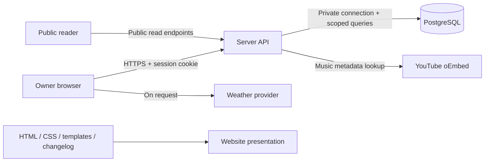
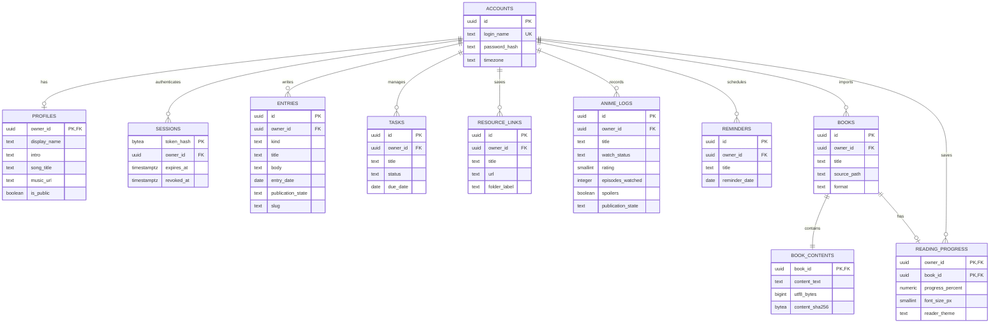

# PostgreSQL database design — Philine’s Picture Book

Design baseline · 6 November 2026. Version 2.0.0 now implements the core schema and API. See [setup](DATABASE-SETUP.md) and [implemented contracts and differences](API-REFERENCE.md). This document preserves the original design rationale; deployment and migration of existing browser data still require setup. The implementation adds an operational import-receipt table, uses empty-account import only, and does not enable RLS.

## 1. Scope and assumptions

Replace the browser notebook and imported-book stores with PostgreSQL as the authoritative store, accessed through an authenticated server API. Keep the current HTML/CSS presentation. Start with one owner who can use the notebook across devices; visitors can read deliberately published content. Public sign-up, collaboration, comments, playlists, and a shared anime catalogue are outside the first version.

This proposal is based on `assets/js/picturebook.js`, `templates/components.html`, `scripts/serve.mjs`, and the existing documentation. It inspects the application’s storage contract, not actual browser records. Actual saved data must be validated during import.

Important current behaviour:

- `localStorage['philine-picturebook-v1']` contains the profile, posts, blogs, tasks, documents, anime logs, calendar events, and reading positions.
- IndexedDB `philine-books`, object store `books`, contains `{id, title, text}`. IDs are filenames or relative paths, not reliable UUIDs.
- Profile music is metadata and a link, not stored audio. Labels may be edited manually.
- Documents are external links, not uploaded document files.
- Every TXT/MD file currently becomes a separate book; a folder is not yet a multi-chapter novel.
- Public export currently includes the complete profile, notes, blogs/stories, and anime logs. It does not establish a per-record publishing decision.
- The server currently serves static files and performs a music metadata lookup. It has no authentication or persistent database layer.

## 2. System boundary



The browser never receives database credentials or a direct SQL connection. The API derives the owner identity from the session, rather than accepting an owner ID as proof of permission. PostgreSQL stores durable records; the browser can retain temporary UI state, but must not report an unsaved server write as saved. Offline editing is a later feature requiring an explicit sync design.

## 3. Relationship diagram

`||` means exactly one; `o|` zero or one; `o{` zero or many. All content belongs to an account, even when that ownership edge is omitted from a simplified overview.



Eleven tables cover the current product plus account access. The diagram shows principal fields; the dictionary below is authoritative for the complete proposal. A book and its content must be created in one transaction. A content-to-book foreign key prevents orphan text; the API transaction enforces that every new book also receives content.

## 4. Column conventions

- IDs: UUIDs generated by the server. Do not assume imported browser IDs are UUIDs.
- Content tables `entries`, `tasks`, `resource_links`, `anime_logs`, `reminders`, and `books` share: `id uuid PRIMARY KEY`, `owner_id uuid NOT NULL REFERENCES accounts(id)`, `created_at timestamptz NOT NULL`, `updated_at timestamptz NOT NULL`, `revision bigint NOT NULL DEFAULT 1 CHECK (revision > 0)`, and nullable `deleted_at timestamptz`.
- `profiles` and `reading_progress` also have `created_at`, `updated_at`, and `revision`, with the same types and rules. They have their own keys and no soft-delete column.
- The six content tables additionally have nullable `legacy_source text`, `legacy_collection text`, `legacy_id text`, and `legacy_position integer`. Require the three identity columns to be all null or all non-null. A unique constraint on `(owner_id, legacy_source, legacy_collection, legacy_id)` makes a repeat of the same migration idempotent. These fields stay private and are not public API fields.
- `legacy_source` is an import-source identifier recorded in the migration manifest and reused on retry; it is not the content hash of each new export. `legacy_position` preserves existing array order during migration, because creation times are unknown.
- Dates entered by people use `date`; server activity uses `timestamptz`. Use `Asia/Ho_Chi_Minh` as the initial account timezone. A calendar reminder remains on its chosen date across timezones.
- Unless marked nullable or given a default below, fields are required. Optional text uses `NOT NULL DEFAULT ''` consistently; absent dates use SQL `NULL`, not empty strings.
- Server timestamps default to the transaction time. Every successful update increments `revision` and sets `updated_at`; defaults alone do not maintain update timestamps.
- Every required title/display name/login name must have non-whitespace content. API limits for titles, bodies, and total request sizes must be defined before implementation; do not silently truncate imports.

## 5. Table dictionary

### accounts — private identity

| Column | Type / rule |
| --- | --- |
| id | uuid, primary key |
| login_name | text, canonical lowercase, unique, nonblank |
| password_hash | text, encoded password hash; never a plaintext password |
| timezone | text, default `Asia/Ho_Chi_Minh`; validated IANA timezone |
| created_at, updated_at | timestamptz |
| disabled_at | timestamptz, nullable |

Create the first owner through a controlled server-side setup process. No public registration endpoint. Local password authentication is the baseline proposal; if a managed identity provider is chosen, replace the password field with a unique provider/subject mapping before implementation. Email, password recovery, and provider choice are not assumed to exist.

### sessions — private login sessions

| Column | Type / rule |
| --- | --- |
| token_hash | bytea, primary key; SHA-256 digest of a high-entropy opaque token |
| owner_id | uuid, foreign key to accounts |
| created_at, expires_at | timestamptz; expiry must be after creation |
| revoked_at | timestamptz, nullable |

Only the browser receives the raw token, in a Secure, HttpOnly, SameSite cookie. Validate expiry, revocation, and account status on every protected request. Revoke sessions on logout and credential reset. Add CSRF protection/origin checks to cookie-authenticated writes. Session lifetime is a deployment setting; expired/revoked rows are periodically purged. Exclude sessions and credential fields from ordinary notebook exports.

### profiles — one editable corner per account

`owner_id uuid PRIMARY KEY REFERENCES accounts(id)`; shared timestamps/revision apply.

| Column | Type / mapping |
| --- | --- |
| display_name | text ← `profile.name` |
| bio, status, intro | text, default empty ← same-named profile fields |
| currently_watching | text, default empty ← `watching` |
| currently_playing | text, default empty ← `playing` |
| currently_doing | text, default empty ← `doing` |
| song_title | text, default empty ← `song` |
| song_artist | text, default empty ← `artist` |
| music_cover_url | text, default empty ← `musicCover` |
| music_url | text, default empty ← `musicUrl` |
| is_public | boolean, default false |

Keep current music metadata here because the app has one music selection, with independently editable title/credit. A track catalogue or playlist would add complexity without serving current behaviour. Validate nonempty music URLs and cover URLs as HTTP(S); music labels may exist without a URL. Public profile responses use an explicit field allowlist. `is_public` covers the whole public profile, including current music.

### entries — daily notes, blogs, and stories

Shared content columns apply.

| Column | Type / rule |
| --- | --- |
| kind | text, check `note`, `blog`, or `story` |
| title, body | text, nonblank |
| entry_date | date ← browser `date` |
| tags_text | text, default empty ← browser `tags`, preserved verbatim |
| slug | text, nullable; unique `(owner_id, slug)` when present; nonblank URL-safe value |
| publication_state | text, check `draft` or `published`, default `draft` |
| published_at | timestamptz, nullable; required exactly when published |

One table fits these records because their fields and page behaviour are nearly identical. Map `posts` to `kind=note`; map `blogs` with `category=Blog` to `blog`, and `category=Story` to `story`. The API still returns the old page categories as necessary. Do not split tags into a join table until actual structured tagging is requested: existing freeform text has no dependable delimiter contract.

Slug is an optional foundation for later permalinks, not a promise of routes in the current site. Preserve slug uniqueness across trash so links cannot be silently reassigned. Public reads require published state and `deleted_at IS NULL`. Publishing sets `published_at`; unpublishing clears it. Editing a published row updates its public content immediately after an explicit “Save published changes” action. Keeping an unpublished edit alongside a live version would require revisions/publication snapshots in a later design.

### tasks — private work board

Shared content columns apply.

| Column | Type / rule |
| --- | --- |
| title | text, nonblank |
| note | text, default empty |
| due_date | date, nullable ← `due` |
| status | text, check `todo`, `in_progress`, or `done` |

Map the current labels `To do`, `In progress`, and `Done` to these stable values. Tasks remain private; there is no publication flag.

### resource_links — private document cabinet

Shared content columns apply.

| Column | Type / rule |
| --- | --- |
| title | text, nonblank |
| url | text, nonblank HTTP(S) URL |
| folder_label | text, default empty ← `folder` |
| note | text, default empty |

Folder is currently a freeform label, so no folder table is necessary. Duplicate URLs are allowed: two records may have different subjects or notes. The API validates URLs; a database scheme check is only a secondary guard, not a complete URL parser. No file binaries are stored here.

### anime_logs — personal watch records

Shared content columns apply.

| Column | Type / rule |
| --- | --- |
| title | text, nonblank |
| watch_status | text, check `watching`, `completed`, `on_hold`, `planned` |
| rating | smallint, nullable; check 1–5 when present |
| episodes_watched | integer, check >= 0, default 0 |
| log_date | date ← `date` |
| thoughts | text, default empty ← `body` |
| spoilers | boolean, default false |
| publication_state, published_at | same rules as entries |

Map all four current status labels explicitly. Do not require a completed log to have a rating. There is no total episode count in the existing app, and titles need not be unique. Spoiler flags affect presentation; they do not grant or restrict access. A catalogue, rewatch history, or external service IDs can be added when those features exist.

### reminders — private calendar notes

Shared content columns apply. Additional fields: `title text NOT NULL` (nonblank) and `reminder_date date NOT NULL` ← `events[].date`. Multiple reminders on a date are valid. There is no scheduled time, recurrence, or notification delivery in the current app.

### books — private shelf metadata

Shared content columns apply.

| Column | Type / rule |
| --- | --- |
| title | text, nonblank |
| source_path | text, default empty; imported filename/relative path, never a trusted filesystem path |
| format | text, check `txt` or `md` |

Do not use source paths as primary keys or make them globally unique. A different folder can contain a book with the same filename. A migration’s stable legacy key identifies the existing browser record; later uploads with a matching filename must ask whether to replace or keep both. They must not silently overwrite text.

### book_contents — private book text, loaded on demand

| Column | Type / rule |
| --- | --- |
| book_id | uuid, primary key and foreign key to books(id), `ON DELETE CASCADE` |
| content_text | text, required; empty file allowed |
| utf8_bytes | bigint, derived from UTF-8 octet length; check 0–10,485,760 |
| content_sha256 | bytea, 32-byte digest of the stored UTF-8 text |

Store the current TXT/MD text in PostgreSQL. Keeping it separate prevents shelf/list queries from loading entire novels. Enforce the input file’s 10 MiB limit before decoding, and the stored UTF-8 limit after decoding; report any encoding expansion instead of truncating. Compute derived fields server-side; use a generated byte-length column or equivalent database enforcement so it cannot disagree with text.

Render imported text as text, preserving current behaviour. Format `md` does not imply raw HTML is safe. Future large PDFs, EPUB originals, images, and audio belong in object storage with PostgreSQL metadata; they are outside this first schema. Chapters are also deferred: one imported file remains one book.

### reading_progress — private cross-device bookmark

| Column | Type / rule |
| --- | --- |
| owner_id | uuid, foreign key to accounts; part of primary key |
| book_id | uuid, part of primary key |
| progress_percent | numeric(5,2), check 0–100, default 0 |
| font_size_px | smallint, check 14–30, default 18 |
| reader_theme | text, check `light` or `dark`, default `light` |

Shared timestamps/revision apply. Composite primary key: `(owner_id, book_id)`. Add `UNIQUE(owner_id, id)` on books and a composite foreign key `(owner_id, book_id) REFERENCES books(owner_id, id) ON DELETE CASCADE`. This prevents saving a bookmark against another account’s book. Book text access also checks the parent book’s owner and trash state.

Current `reading[bookId].progress` maps to percentage and `.font` to font size. Theme persistence is a small proposed addition: current theme is transient and imports default to light. Percentage is approximate when devices wrap text differently. Precise chapter/text anchors are a later reader feature. A bookmark can exist only for an imported book owned by that account.

## 6. Privacy, ownership, and publishing

| Data | Owner access | Anonymous access |
| --- | --- | --- |
| Profile and current music | Read/edit | Allowlisted fields only when `is_public` |
| Entries and anime logs | Read/edit/publish | Published, nondeleted records only |
| Tasks, links, reminders | Read/edit | None |
| Books, text, bookmarks | Read/edit | None |
| Accounts and sessions | Controlled identity operations | None |

Use a separate migration role for schema changes and a restricted runtime role for the API. No anonymous SQL access. Every protected query is scoped to the authenticated account, including item-by-ID routes and writes; never fetch by ID alone and rely on the UI to hide it. Public list, detail, search, and export endpoints must all apply the same publication predicate and explicit output field allowlists. Keep private API responses out of shared caches.

Row-level security can add defence in depth, using transaction-local account context set only by the server. Design and test policies for public reads, owned reads/writes, and book-content parent ownership before enabling them. The runtime role must not be superuser, have BYPASSRLS, or accidentally own tables and bypass policies. Do not treat enabling RLS alone as complete authorization. See [PostgreSQL row security documentation](https://www.postgresql.org/docs/17/ddl-rowsecurity.html).

New and migrated content defaults to private/draft. Existing public snapshots do not automatically authorize publishing every local record. Provide a preview and explicit selection for the owner to publish. Authenticated routes must stop falling back to an old browser notebook or public snapshot as if it were current server data.

## 7. Constraints, indexes, and deletion

Use CHECK constraints for finite status values, numerical ranges, nonblank required text, publication timestamp consistency, and legacy identity completeness. Keep NOT NULL constraints separate where absence is forbidden: a CHECK alone does not reject null. Use foreign keys for relationships rather than cross-table CHECK expressions. See [PostgreSQL constraints documentation](https://www.postgresql.org/docs/18/ddl-constraints.html).

Initial indexes, in addition to primary/unique keys:

| Table | Index / purpose |
| --- | --- |
| entries | `(owner_id, kind, entry_date DESC, id)` where not deleted; page lists |
| entries | `(owner_id, kind, entry_date DESC, id)` where published and not deleted; public lists |
| tasks | `(owner_id, status, due_date, id)` where not deleted |
| resource_links | `(owner_id, updated_at DESC, id)` where not deleted |
| anime_logs | `(owner_id, watch_status, log_date DESC, id)` where not deleted |
| anime_logs | `(owner_id, log_date DESC, id)` where published and not deleted |
| reminders | `(owner_id, reminder_date, id)` where not deleted; calendar month range |
| books | `(owner_id, title, id)` where not deleted |
| sessions | `(owner_id)` for revocation and `(expires_at)` for cleanup |
| reading_progress | `(book_id)` for deletion/reference lookups |

Public routes select the configured site owner, so ownership-leading indexes still fit one-owner publishing. Start substring search with parameterized `ILIKE` at notebook scale; B-tree indexes above do not accelerate arbitrary substring searches. Consider trigram indexing only after measuring real search needs. Do not add a GIN index to every text field preemptively.

Ordinary delete sets `deleted_at` and increments revision on the six content tables. Public queries hide deleted rows immediately. Trash can restore them. Book contents/bookmarks remain while the book is in trash, but are inaccessible through ordinary reader routes. Permanently purging a book cascades to content and bookmarks. Keep account deletion restricted while dependent records exist; a later explicit account-deletion workflow can remove them transactionally. Slugs and legacy import keys stay reserved until permanent purge.

## 8. Writes, conflicts, and API shape

Use transactions for book+text creation, replacement+bookmark reset, multi-record restore/import, and permanent purge. For book text replacement, increment the book revision and reset its existing percentage to zero in the same transaction; retaining a position against changed text needs an explicit future policy.

Protect against two devices overwriting each other:

```sql
-- Design example only; use parameters, never string interpolation.
UPDATE entries
SET title = $1, body = $2, updated_at = now(), revision = revision + 1
WHERE id = $3 AND owner_id = $4 AND revision = $5 AND deleted_at IS NULL
RETURNING *;
```

The API requires the revision last read by the client. A stale revision returns a conflict and preserves the user’s unsaved text for review; it does not silently overwrite a newer edit. Apply this rule to profile, tasks, anime, links, reminders, books, and reading progress too. Inserts use unique keys to reject duplicate rows rather than creating hidden duplicates.

Suggested API groups (contracts, not implemented endpoints):

- `/api/auth/login`, `/logout`, `/session`.
- `/api/me/profile`, `/entries`, `/tasks`, `/resource-links`, `/anime-logs`, `/reminders`, `/books`; item routes for individual records.
- `/api/me/books/:id/content` and `/progress`; shelf responses omit book text.
- Explicit publish/unpublish actions for entries/anime; explicit profile-public setting.
- `/api/public/profile`, `/entries`, `/anime-logs`; read-only, allowlisted responses.
- `/api/me/export`, `/import/preview`, `/import/commit` for validated owner-only backups and restores.

Use bounded pagination, server-side filtering, prepared queries, and request size limits. Mutation responses should confirm committed data and its new revision before the UI displays success. Keep the current music lookup as an external metadata service; saving its result updates the profile through the protected API.

## 9. Migration plan — browser stores to server

1. Export a complete existing backup `{notebook, books}` from each browser/origin that holds unique data. The server cannot discover other browsers’ localStorage/IndexedDB. A public `site-content.js` file is not a complete private backup.
2. Establish the owner account. Keep the old application and backup untouched throughout the migration.
3. Parse and validate the entire backup server-side before writing: version, every record, actual types, dates, finite numbers, statuses, URLs, book sizes, duplicate IDs, and reading references. Return a field-level error report and counts. The current browser validation is not sufficiently strict for a database import.
4. Build a migration manifest with a stable source ID, source collection/ID to new UUID mappings, original array positions, counts, and an input checksum. Reuse it on retry. Preserve a private original backup because unknown fields must be reported rather than silently discarded.
5. Convert using the map below. Browser numeric form values are strings: convert only validated finite integral values. Empty optional due dates become null; missing optional labels become empty text. Invalid or ambiguous dates/statuses must be reported, not guessed. Missing historical timestamps get migration time, explicitly marked as unknown history in the report.
6. Resolve legacy IDs separately by collection. Allocate UUIDs for filename/path-based book IDs, then connect `reading[oldBookId]` through that mapping. Orphan bookmarks must appear in the preview report and require an explicit skip decision; never attach one by title similarity.
7. Preview the resulting notebook and counts with everything private/draft. Books remain one file per book. Preserve existing list order using `legacy_position` in the compatibility API until the owner chooses a date-based order. Imported new records can use creation time for normal ordering; make that ordering change visible.
8. Commit all records in one transaction after preview acceptance. Bind commit to the exact previewed checksum/source/account so a different file cannot replace the reviewed data. An import failure rolls back all rows.
9. Reconcile record counts, preserved text/Unicode, book digests, bookmarks, music labels/artwork/URL, and visibility. Re-importing the same source/key must be a no-op or report a conflict, never duplicate content or silently replace server edits.
10. Switch the UI to the API only after reconciliation. Keep old browser data as a recovery source until the owner explicitly clears it. Read back a few records on another device and confirm public/private access before retiring local writes.

| Existing location | Destination |
| --- | --- |
| `profile` | profiles; music fields included |
| `posts[]` | entries with `kind=note` |
| `blogs[]` | entries with kind derived from category |
| `tasks[]` | tasks |
| `documents[]` | resource_links |
| `anime[]` | anime_logs |
| `events[]` | reminders |
| IndexedDB `books[]` | books + book_contents |
| `reading[bookId]` | reading_progress through book UUID mapping |
| notebook `version` | import/export format version, not an account/content field |

For a later backup restore, default to an empty account or an explicit conflict-reviewed merge. Destructive replacement of existing server content needs its own preview and recovery snapshot. Do not implement restore as “delete everything first.” Browser notebook exports provide portability; they are separate from database backups. Deployment also needs automated PostgreSQL backups and a tested restore procedure.

## 10. What stays outside PostgreSQL

| Item | Storage / reason |
| --- | --- |
| HTML, CSS, templates, fonts, artwork | Project files; versioned presentation assets |
| `data/changelog.json`, version notes | Source-controlled release history |
| Weather response and coordinates | Transient request results; no history requested |
| Calculator/word-counter/random-choice inputs | Transient utility inputs |
| Extractor images/results | Existing external-service flow; no save-history feature requested |
| Passwords/session tokens in plaintext | Never stored; keep only the appropriate hashes |
| Future large binary uploads | Object storage; add metadata/ownership tables when needed |

`data/site-content.js` becomes a legacy import/static-export option after migration; do not keep it as a competing editable source for live content. Database connection secrets belong in server configuration outside the static file-serving root. The current server exposes ordinary project files, so any future backups, private exports, or configuration files must not be placed in its served tree.

## 11. Decisions to settle before implementation

The design is usable with these baseline choices: one owner, visitors read only published material, book text lives in PostgreSQL, and current music stays part of the profile.

- Choose hosting for the server and PostgreSQL. A static-only deployment cannot run this architecture.
- Choose local owner authentication or a managed identity provider, plus a recovery process.
- Confirm that published edits may update live immediately. If separate draft edits are required, add publication snapshots before building authoring.
- Confirm whether visitors should eventually have their own private notebooks. This schema has ownership boundaries, but public sign-up and account lifecycle would still need design work.
- Set backup retention, trash retention, session lifetime, and upload/request quotas for the selected host.

Implementation acceptance checks should cover: unauthorized private reads/writes, anonymous publication filtering, cross-owner book/progress rejection, stale-revision conflicts, constraint boundaries, failed-import rollback, repeated-import behaviour, text/music round trips, and a real database backup restore. These are future implementation checks, not claims of tests already run.
